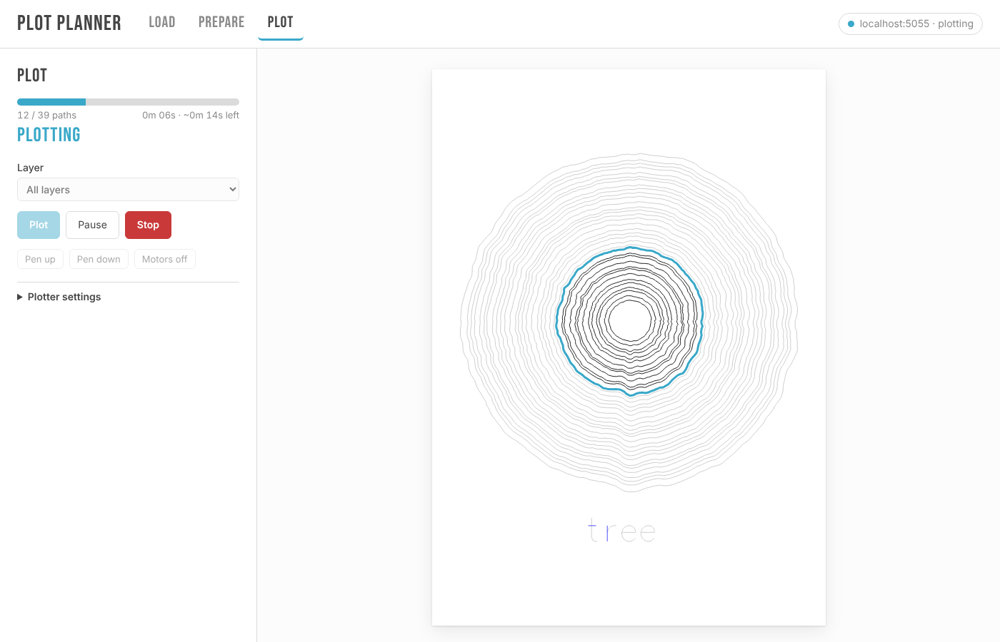

# PlotPlanner

Load an SVG, optimize it for the pen, and plot it on an iDraw or AxiDraw. You can drive it
from the computer the plotter is plugged into, or remotely from any browser.



- **Prepare:** paper size and orientation, margins, scale to fit, plus vpype's `linemerge`,
  `linesort` (optionally two-opt), `reloop` and `linesimplify`. You see the pen-up travel before
  and after, and can download the optimized SVG.
- **Layers:** Inkscape layers, including LineDream's `Group(label=...)`, are kept, so you can
  plot one layer at a time for pen changes.
- **Plot:** live progress drawn on the preview (paths done, the current path, time left), with
  pause, resume, and stop-and-home. Pen up/down and motors off for setup.
- **Remote:** a small JSON API with a static control page. Point any copy of the page at
  the server, so several browsers can watch the same plot.

## Install

PlotPlanner is a [uv](https://docs.astral.sh/uv/) project (Python 3.11 to 3.13).

```bash
uv sync
uv run plotplanner serve          # http://localhost:5001
```

Or install it as a tool: `uv tool install git+https://github.com/marcrleonard/PlotPlanner`.

## Use

### The control page

`plotplanner serve` serves the API and the page at `http://localhost:5001`. To control the
plotter from another machine, listen on the network and set a token:

```bash
uv run plotplanner serve --host 0.0.0.0 --token "$(openssl rand -hex 16)"
```

Click the connection pill in the top-right corner to set the server URL and token. The page in
`src/plotplanner/static/` is plain HTML, CSS and an ES module with no build step, so you can also
host it anywhere else (GitHub Pages, a LAN box) and point it at the server.

`--preview` simulates plots without a plotter, which is handy for working on the UI.

### The command line

```bash
uv run plotplanner optimize drawing.svg --paper a4 -o drawing-opt.svg
uv run plotplanner plot drawing.svg --paper a3 --margin 20   # Ctrl-C pauses, again stops + homes
uv run plotplanner plot drawing.svg --as-is --layer 2
uv run plotplanner pen up          # also: pen down, motors off, connection, version
```

Plotter settings (pen heights, speeds, machine size) are saved on the server in
`~/.config/plotplanner/settings.json` (or your platform's equivalent). Change them on the page
or through `POST /api/settings`.

### API

All endpoints are under `/api` and use JSON. Send `Authorization: Bearer <token>` when the server
has a token.

| | |
|---|---|
| `GET /info` | version, paper sizes, defaults, current settings |
| `GET /status?since=N` | `state` (idle / plotting / paused / stopping), `plot_id`, `paths_done` / `paths_total`, `current_path`, the completed path ids after the first `N`, messages, error |
| `GET /connection` | connected plotters (lists ports, never opens them) |
| `GET /document` | the SVG being plotted, so a late client can draw progress |
| `POST /optimize` | `{svg, options}` → `{svg, paths, layers, before, after}` |
| `POST /plot` | `{svg, settings?, layer?}` |
| `POST /pause` · `/resume` · `/stop` | |
| `POST /manual` | `{command}`: `raise_pen`, `lower_pen`, `enable_xy`, `disable_xy`, `fw_version` |
| `GET/POST /settings` | read, update, or `{reset: true}` |

Path ids (`pp_1`, `pp_2`, …) are assigned by the server in plot order, so a client can colour
progress by id.

## The driver

`src/plotplanner/_vendor/` is iDraw's build of the AxiDraw 2.7.0 driver, taken from the bundle in
`bin/idraw_inkscape/`. Compared with stock AxiDraw, the iDraw differs only in steps per inch
(1270 vs 1016) and servo range (7500–28000 vs 10800–25200); the motion planning and EBB
protocol are the same. See [`_vendor/README.md`](src/plotplanner/_vendor/README.md) for details
and the small patches applied.

`plotplanner/driver.py` wraps it with two hooks: per-path progress callbacks, and a pause
request that another thread can set. The plot runs on a single worker thread, which is the only
code that touches the serial port.

## Develop

```bash
uv run pytest
```

The tests run real plots, including pause, resume and stop, against a fake EiBotBoard
(`tests/conftest.py`).
