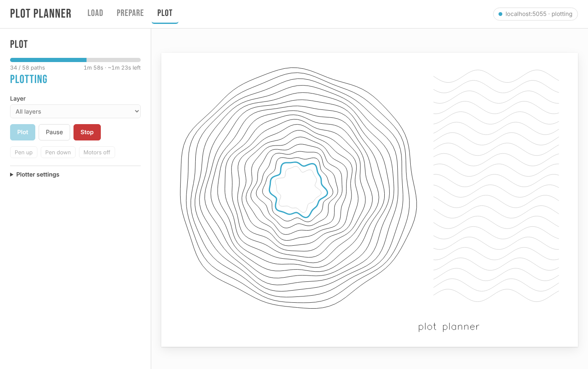
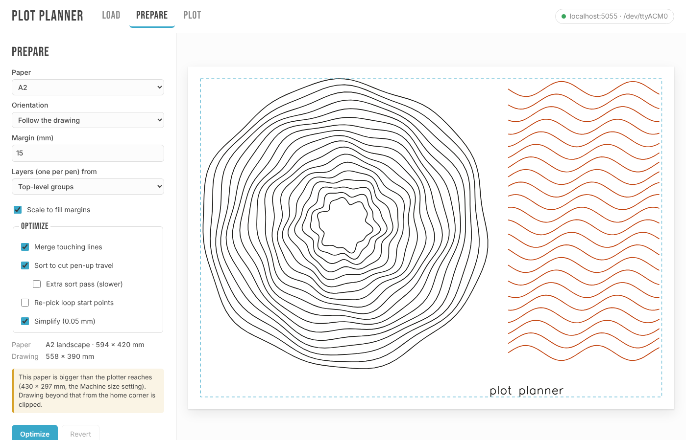
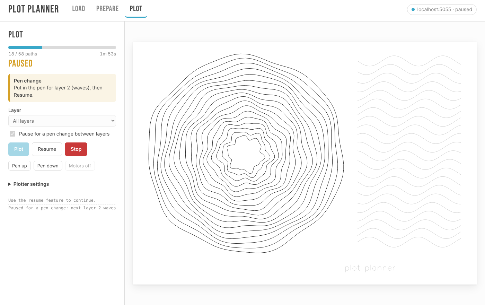
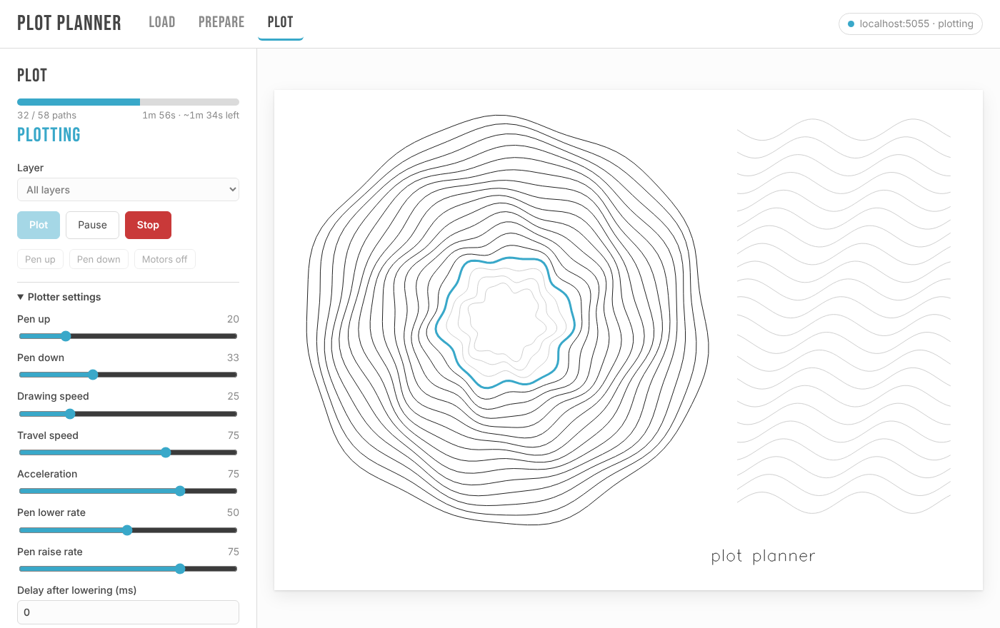
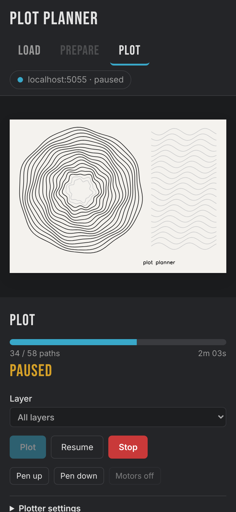

<h1 align="center">PlotPlanner</h1>

<p align="center">
  <strong>Load, lay out, optimize and plot SVGs on an iDraw or AxiDraw pen plotter.</strong><br>
  From the computer the plotter is plugged into, or from any browser on your network.
</p>

<p align="center">
  <a href="https://github.com/marcrleonard/PlotPlanner/actions/workflows/test.yml"></a>
  <a href="pyproject.toml"></a>
  <a href="https://docs.astral.sh/uv/"></a>
  <a href="https://github.com/marcrleonard/LineDream"></a>
</p>

<p align="center">
  
</p>

---

PlotPlanner turns an SVG into ink in three steps. **Load** a file. **Prepare** it: pick the
paper, see the drawing laid out on it at real size, and let [vpype](https://github.com/abey79/vpype)
cut the pen-up travel. **Plot** it, watching each path turn black as the pen draws it. You can pause,
resume, swap pens between layers, or tune pen pressure without stopping.

The plotter side is a small JSON API. The control page is static HTML that can be served by
PlotPlanner or from anywhere else, so the plotter can sit on a Raspberry Pi in the corner while
you drive it from a laptop or phone.

<table>
  <tr>
    <td width="50%"></td>
    <td width="50%"></td>
  </tr>
  <tr>
    <td><b>Paper preview.</b> The drawing laid out on the chosen sheet at real size, with the margin guide, and a warning when the paper outgrows the machine.</td>
    <td><b>Pen changes.</b> One layer per pen. It pauses before each new layer, tells you which pen goes in, and carries on when you hit Resume.</td>
  </tr>
  <tr>
    <td></td>
    <td align="center"></td>
  </tr>
  <tr>
    <td><b>Live settings.</b> Change pen heights, speeds and acceleration while it plots. They apply from the next move.</td>
    <td><b>Any browser.</b> A phone that joins mid-plot picks up the drawing and its progress from the server.</td>
  </tr>
</table>

## Quickstart

```bash
git clone https://github.com/marcrleonard/PlotPlanner && cd PlotPlanner
uv run plotplanner serve            # then open http://localhost:5001
```

[uv](https://docs.astral.sh/uv/) installs Python and the dependencies on first run. No plotter
handy? `uv run plotplanner serve --preview` simulates one.

To install the command globally: `uv tool install git+https://github.com/marcrleonard/PlotPlanner`.

## What's in the box

| | |
|---|---|
| **Layout** | A file with a real size (mm, cm, in) plots at that size on its own page by default. Otherwise choose a paper preset (A6 to A2, Letter, Legal, Tabloid) or a custom size, with orientation, margins, and scale-to-fit or centre-only. The preview updates as you change them, shows the drawing's size in mm, and warns when the drawing runs off the paper or past what the machine can reach. |
| **Optimize** | vpype's `linemerge`, `linesort` (optionally two-opt), `reloop` and `linesimplify`. You see pen-up travel before and after, typically 80%+ less, and can download the optimized SVG. |
| **Layers and pens** | Each top-level group (Inkscape layer, LineDream `Group(label=…)` or plain `<g>`) becomes a layer, and drawing outside any group gets its own. Or make one layer per stroke colour. Plot one layer, or all of them with a pause before each layer to swap pens. |
| **Plot** | Live progress on the preview, with paths done, the current path and time left. Pause, resume, and stop-and-home. Pen up, pen down and motors off for setup. |
| **Live settings** | Pen heights, pen rates and delays, speeds, acceleration and constant speed change mid-plot. A new pen height is sent at once, so you can dial in pressure mid-stroke. Machine size, resolution, rotation and port stay locked until the plot ends. Changes made while paused apply on resume. |
| **Remote** | One server, any number of browsers. Every page sees the same plot, progress and settings. An optional bearer token protects the API. |

## Plotting from LineDream

[LineDream](https://github.com/marcrleonard/LineDream) groups become PlotPlanner layers, so give
each pen its own `Group`. Then send the sketch straight to the plotter with nothing but the
standard library:

```python
import json
import urllib.request

from LineDream import Canvas, Circle, Group

Canvas.width, Canvas.height, Canvas.units = 420, 297, "mm"
black, red = Group(label="black"), Group(label="red")
for r in range(10, 140, 6):
    black.add_item(Circle(210, 148, r))
    red.add_item(Circle(210, 148, r + 3, stroke_color="#C2410C"))

def api(path, body, server="http://localhost:5001"):
    request = urllib.request.Request(f"{server}/api{path}", json.dumps(body).encode(),
                                     {"Content-Type": "application/json"})
    return json.load(urllib.request.urlopen(request))

svg = Canvas.save("", as_string=True)
optimized = api("/optimize", {"svg": svg, "options": {"paper": "a3", "margin": 15}})
api("/plot", {"svg": optimized["svg"], "pen_changes": True})  # pauses before "red" for the swap
```

Open the control page to watch it, and hit Resume after each pen change.

## Running it next to the plotter

Listen on the network and set a token:

```bash
uv run plotplanner serve --host 0.0.0.0 --token "$(openssl rand -hex 16)"
```

On the page, click the connection pill in the top-right corner and enter the server URL and
token. The page in `src/plotplanner/static/` has no build step, so you can also host a copy
elsewhere (GitHub Pages, say) and point it at the server.

<details>
<summary>Keep it running on a Raspberry Pi (systemd)</summary>

```ini
# /etc/systemd/system/plotplanner.service
[Unit]
Description=PlotPlanner
After=network-online.target

[Service]
User=pi
Environment=PLOTPLANNER_TOKEN=change-me
ExecStart=/home/pi/.local/bin/plotplanner serve --host 0.0.0.0
Restart=on-failure

[Install]
WantedBy=multi-user.target
```

Install the command with `uv tool install git+https://github.com/marcrleonard/PlotPlanner`, then
run `sudo systemctl enable --now plotplanner`. On Linux the user needs serial access:
`sudo usermod -aG dialout pi`.

</details>

## Command line

```bash
plotplanner serve [--host 0.0.0.0] [--port 5001] [--token …] [--preview]

plotplanner optimize drawing.svg --paper a4 -o drawing-opt.svg
plotplanner plot drawing.svg --paper a3 --margin 20        # Ctrl-C pauses; again stops and homes
plotplanner plot drawing.svg --pen-changes --layers-from color
plotplanner plot drawing.svg --as-is --layer 2

plotplanner pen up               # also: pen down, motors off, connection, version
```

`--paper` takes a preset, `WxH` in mm (`300x400`), or `source` to keep the file's own page.
Run `plotplanner <command> --help` for the rest.

Plotter settings (pen heights, speeds, machine size) live on the server in
`~/.config/plotplanner/settings.json` (or your platform's equivalent), so every client and the
CLI share them.

## API

JSON under `/api`. Send `Authorization: Bearer <token>` when the server has a token.

| Endpoint | |
|---|---|
| `GET /info` | Version, paper sizes, defaults, current settings, which settings are live, each machine model's reach. |
| `GET /status?since=N` | `state` (idle, plotting, paused or stopping), `plot_id`, `paths_done`/`paths_total`, `current_path`, the completed path ids after the first `N`, `pen_change`, settings, messages, error. |
| `GET /connection` | Connected plotters. Lists ports, never opens them. |
| `GET /document` | The SVG being plotted, so a client that joins late can draw progress. |
| `POST /optimize` | `{svg, options}` → `{svg, paths, layers, page_mm, bounds_mm, before, after}` |
| `POST /plot` | `{svg, settings?, layer?, pen_changes?}` |
| `POST /pause` · `/resume` · `/stop` | |
| `POST /manual` | `{command}`: `raise_pen`, `lower_pen`, `enable_xy`, `disable_xy` or `fw_version`. |
| `GET/POST /settings` | Read or update (live during a plot), or `{reset: true}`. A locked setting during a plot gets 409. |

The server numbers paths `pp_1`, `pp_2`, … in plot order, so a client can colour progress by id.

## Hardware

PlotPlanner drives EiBotBoard machines: the AxiDraw, and clones such as the iDraw. It ships
iDraw's build of the AxiDraw 2.7.0 driver (`src/plotplanner/_vendor/`, from the bundle in
`bin/idraw_inkscape/`). That build differs from stock AxiDraw only in steps per inch (1270 vs 1016)
and servo range (7500–28000 vs 10800–25200); the motion planning and board protocol are the same.
Set **Machine size** in the plotter settings to match your machine's travel. The default is A3
(430 × 297 mm).

[`_vendor/README.md`](src/plotplanner/_vendor/README.md) lists the few patches applied to the
driver. `plotplanner/driver.py` adds hooks for progress, remote pause, live settings and pen
changes. One worker thread owns the serial port; the API only flips flags and reads state.

## Develop

```bash
uv run pytest
uv run plotplanner serve --preview
```

The tests run real plots against a fake EiBotBoard (`tests/conftest.py`): pause, resume, stop,
live setting changes and pen-change pauses.
